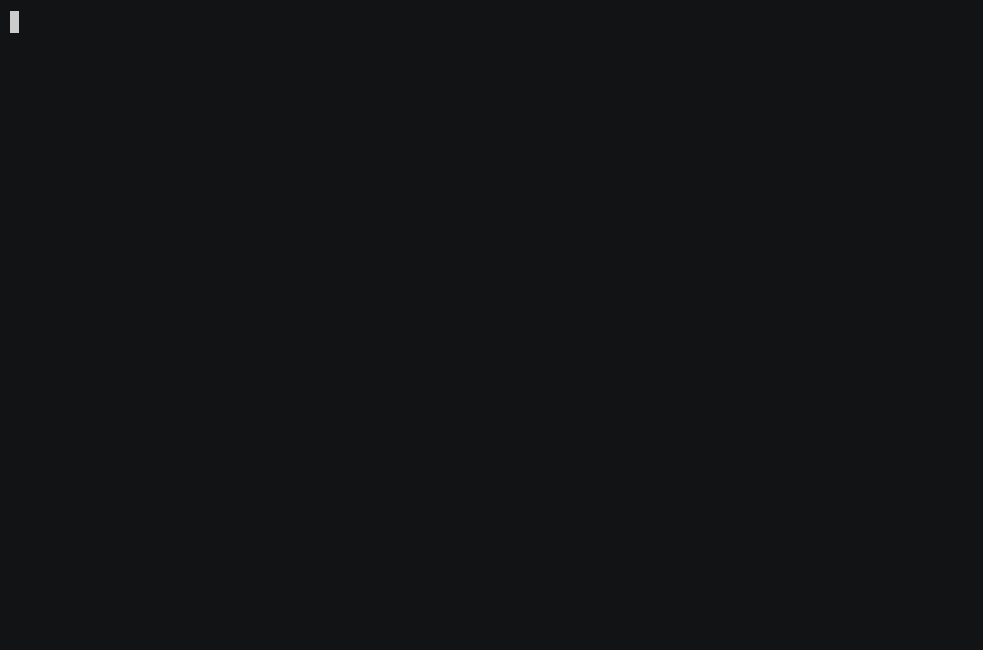

# SafeRoom

[](https://github.com/kascadeceo/saferoom/actions)
[](LICENSE)
[](https://www.python.org)
[](saferoom.py)

**The sign-off layer for AI coding agents.** Cloud sandboxes solve where agent
code runs. SafeRoom solves what ships.

SafeRoom clones your repo into an isolated Docker container, swaps live
credentials for dummies, lets your agent run free, and hands you a full audit
trail — files changed, commands run, clean diffs. Nothing reaches your real
code until you approve it.

```
your repo ──clone──▶ sandbox container ──agent works──▶ audit report ──you approve──▶ your repo
                     (dummy .env, no prod access)       (diff + command log)
```



## Why

Nearly half of AI-generated code fails security tests (Veracode, 2025). Claude
Code and Cursor can refactor your whole backend from one prompt — and one
hallucinated migration can drop your production tables. Sandboxes contain the
blast. SafeRoom contains the decision: what the agent produced only ships after
you've seen the diff.

## Install

**Linux (Debian/Ubuntu):**

```bash
git clone https://github.com/kascadeceo/saferoom && cd saferoom
sudo ./install.sh   # installs git/python3/docker.io only if missing; leaves an existing Docker alone
```

**macOS:** install [Docker Desktop](https://www.docker.com/products/docker-desktop/),
then `sudo ./install.sh`.

Single-file Python, stdlib only. If you can read `saferoom.py` in one sitting —
and you can — you know exactly what runs on your machine.

## Quick start

```bash
cd your-project
saferoom init                  # scans .env*, writes dummy-credential template + config
saferoom run                   # interactive sandbox shell — point your agent here
saferoom run -- claude -p "refactor the billing module"   # or one-shot
saferoom review                # audit: files changed, commands run, full diff
saferoom approve               # git-apply the reviewed patch (.env* always excluded)
```

## Commands

| Command | What it does |
|---|---|
| `saferoom init` | Build dummy `.env` template and `saferoom.json` config |
| `saferoom run` | Clone repo → mount dummy creds → Docker sandbox → log every command |
| `saferoom run --offline` | Same, with no network in the container |
| `saferoom run --image node:22` | Choose the sandbox image |
| `saferoom run --screenshot URL` | Full-page UI capture after the run (playwright) |
| `saferoom review [session]` | Print the audit report |
| `saferoom approve [session]` | Apply the session patch to your working tree |
| `saferoom sessions` | List past sessions (`--json` adds review state, patch hash, machine-readable) |
| `saferoom gate` | Check session decisions; unknown, malformed and stale records block. Install the outgoing-commit check with `gate --install-hook --trusted-base HEAD` only after reviewing the existing history. `--dismiss SESSION` and `--reject SESSION` close unapplied work without granting shipping permission |
| `saferoom clean` | Delete oldest sessions, keep the newest 10 (`--keep N` to change); reports space freed |

## Guarantees

- Real credential values never enter the container — only generated dummies do.
- `approve` never writes `.env*` files back, even if the agent edited them.
- The sandbox is a throwaway clone; your working tree is untouched until approval.
- Everything is local. No telemetry, no account, no cloud.

## How SafeRoom relates to sandboxes you already use

E2B, Modal, and Daytona provide isolated compute for teams building agent
products. Claude Code's `/sandbox` and Cursor's sandbox mode contain the agent
while it runs. SafeRoom wraps around any of them: credential stripping, an
auditable record, and a required approval step before anything touches prod.
Use both.

## Roadmap

- [ ] Database mutation capture (proxy Postgres/MySQL in the sandbox)
- [ ] API-call interception and logging
- [ ] HTML audit reports
- [ ] Hosted session history + CI hooks (paid tier)
- [ ] Compliance-mode logs (HIPAA / SOC 2 evidence format)

## Pro

A hosted tier ($49/mo — session history, CI hooks, priority support) funds
development. The CLI stays MIT-licensed and fully functional forever.
→ https://getsaferoom.netlify.app

## Contributing

See [CONTRIBUTING.md](CONTRIBUTING.md). Issues and PRs welcome — especially
war stories about agents touching things they shouldn't have.

---
Built by [Kascade Security](https://www.kascadesecurity.com). MIT licensed.


## Local push approval

In a deliberately selected repository, review and explicitly trust the existing
history, then run `saferoom gate --install-hook --trusted-base HEAD`. The installer
refuses existing hooks and custom hooksPath rather than replacing them. It installs
an executable pre-push hook pinned to this local Python/CLI path. Moving that CLI
requires reviewing/reinstalling the hook. This is opt-in, not native Maestro enforcement.

`approve SESSION` requires a clean tracked tree/index, computes the exact approved
result in a disposable Git index, applies the permitted patch to the working tree,
and records its base commit, resulting tree and patch SHA-256. Commit exactly those
changes. Each outgoing commit after the trusted installation baseline must have
one parent matching a current approval's base, and exactly match its approved tree.
Extra files, extra intermediate commits and stale approvals fail closed. Separate
approved sessions can cover a linear series of commits. Merges, tags, deletion,
force-push and unavailable remote history are blocked and need separate review.

A pending, unknown, malformed, missing-patch or stale session blocks. Legacy
approvals without base/tree binding block until explicitly reviewed again.
Rejection/dismissal is not approval: it neither applies a patch nor authorizes an
outgoing commit. Separately approved work can still ship. An applied approval
cannot be dismissed; inspect/revert it explicitly. Plain `gate` checks reviews
only; `gate --pre-push` reads Git updates on stdin and checks actual commits.

Limits: a local user/agent can bypass with `git push --no-verify`, change/remove the
hook/config, edit decisions or alter the CLI. No protected human identity or
server-side enforcement is claimed. Commit messages/author metadata are not bound
by tree approval. Do not prune session records needed for unpushed commits. Checks
in session summaries mean the sandbox command exit code, not independent test
certification; legacy sessions report not_recorded. Local evidence reports may
contain sensitive diffs; open only after reviewing the recording boundary.

Run `python3 -B -m unittest discover -s tests -v` for real pushes exclusively to
temporary local bare remotes, including an explicit test proving --no-verify bypass.
