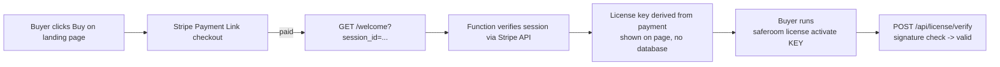

# Founder Runbook — SafeRoom Pro checkout in ~15 minutes

Everything sellable ships in this repo. You do exactly three things once:
connect Netlify, create 3 Stripe Payment Links, paste 5 env vars. No code.



## 1. Netlify (3 min)

1. App: <https://app.netlify.com> → **Add new site → Import an existing project**
   → pick this GitHub repo (`kascadeceo/saferoom`).
2. Nothing to configure: `netlify.toml` already sets publish dir `landing/`
   and functions `netlify/functions/`. Deploy.
3. Use the existing site name `getsaferoom` (the CLI's default license URL is
   `https://getsaferoom.netlify.app/api/license/verify`). Custom domain
   later: Site configuration → Domain management.

## 2. Stripe Payment Links (5 min)

Dashboard: <https://dashboard.stripe.com/payment-links> → **+ New**.

| Product name | Price | Billing |
|---|---|---|
| SafeRoom Pro (monthly) | $39.00 / month | Recurring |
| SafeRoom Pro (annual) | $390.00 / year | Recurring |
| SafeRoom Pro — Lifetime (first 100) | $249.00 | One-time |

For each link, under **After payment → Custom website URL**, set:

```
https://getsaferoom.netlify.app/welcome
```

Stripe appends `?session_id={CHECKOUT_SESSION_ID}` automatically — that is
what the `/welcome` function reads. Copy each link's id (`plink_...`, visible
in the link URL) for step 3.

## 3. Environment variables (2 min)

Netlify → Site configuration → Environment variables. Every one needs the
**Functions** scope (the default "All scopes" is fine).

| Key | Value |
|---|---|
| `STRIPE_SECRET_KEY` | `sk_live_...` (or `sk_test_...` first — see §5) |
| `LICENSE_SECRET` | any long random string, e.g. `openssl rand -hex 32` |
| `PAYMENT_LINK_PRO_MO` | `plink_...` id of the $39/mo link |
| `PAYMENT_LINK_PRO_YR` | `plink_...` id of the $390/yr link |
| `PAYMENT_LINK_LIFETIME` | `plink_...` id of the $249 link |

Save → **Deploys → Trigger deploy** (env changes apply on the next deploy).

> **Keep `LICENSE_SECRET` safe.** Anyone holding it can mint Pro keys. If it
> ever leaks: set a new one, redeploy, and every previously-minted paid key
> stops verifying (eval keys are unaffected — they use a separate, public
> eval secret by design).

## 4. Landing page buy buttons

The landing page ships with buttons pointing at `https://buy.stripe.com/...`
placeholders. Replace each with its real Payment Link URL (the full
`https://buy.stripe.com/xxxx` from step 2) in `landing/index.html` — search
for `PAYMENT_LINK_URL_HERE`. Commit; Netlify redeploys.

## 5. Test the funnel before going live (5 min, strongly recommended)

1. Set `STRIPE_SECRET_KEY` to a `sk_test_...` key and the `PAYMENT_LINK_*`
   vars to **test-mode** payment link ids (create the same 3 links with
   "Test data" toggle on).
2. Open your landing page → click Buy → pay with card `4242 4242 4242 4242`,
   any future expiry, any CVC.
3. You land on `/welcome` with a real-shaped key. Verify it end-to-end:
   ```bash
   SAFEROOM_LICENSE_URL=https://getsaferoom.netlify.app/api/license/verify \
     python3 saferoom.py license activate <KEY-FROM-PAGE>   # -> activated, hosted_verified=True
   ```
   (Or `curl -X POST .../api/license/verify -d '{"key":"..."}'` →
   `{"valid":true,...}`.)
4. Revisit the success URL — same key (idempotent). Refund the test payment
   in Stripe — the page will still show the key (goodwill licensing; refunds
   are handled by rotating `LICENSE_SECRET` if ever needed, per §3).
5. Switch env vars back to live values → trigger deploy. **You're selling.**

## How renewals work (know this for support)

- Keys are derived purely from the Stripe session — **no database exists to
  break**. Monthly/yearly keys carry the subscription's `current_period_end`
  as their expiry; after each billing cycle the buyer revisits their success
  URL (bookmark note is on the page, link is in their receipt) and re-runs
  `saferoom license activate` with the refreshed key.
- Lifetime keys have no expiry.
- Lost success URL? Stripe receipt emails contain it; also Dashboard → the
  checkout session URL. Nothing to restore — the page re-derives the key.

## Day-to-day

- **Logs** (who activated, no keys logged): Netlify → Functions tab.
- **Refunds**: issue in Stripe; optionally rotate `LICENSE_SECRET` to kill
  the refunded key's validity. For a $39 goodwill product, refunding and
  moving on is usually cheaper than any of this.
- **Price change**: edit the Payment Link in Stripe. No deploy needed unless
  the `plink_...` id changes (then update the env var).
